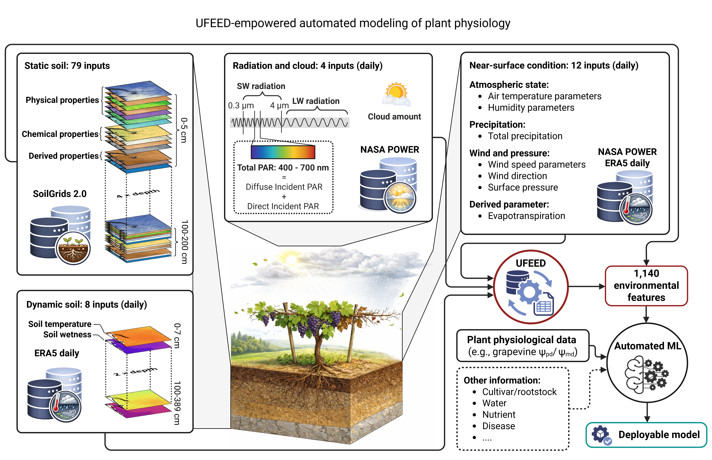

<p align="left">
  &nbsp;&nbsp;
  <strong>UFEED: Universal Feature Extraction from Environmental Data</strong>
</p>

UFEED is an R package for downloading weather and soil data and creating
environmental features for plant physiology and crop modeling.



## Installation

Install the stable, paper-associated release from GitHub:

```r
install.packages("remotes")
remotes::install_github("imbaterry11/UFEED@v0.1.2", dependencies = TRUE)
library(UFEED)
```

Users can also
[download the v0.1.2 source archive](https://github.com/imbaterry11/UFEED/archive/refs/tags/v0.1.2.tar.gz).

### Optional crop model setup (development build)

The crop model setup is available in the development checkout. Install it
from a local checkout with `remotes::install_local("path/to/UFEED")`, then opt in:

```r
setup <- UFEED::UFEED_setup_crop_models(install_r = TRUE)
setup$r_packages
setup$engines
```

This installs missing R wrapper packages and looks for engines on the system
path and in common Windows installation locations. For an engine it cannot
find, the setup table gives the official download page. Install each missing
engine once, then rerun setup. The STICS distribution requires sign-in.

If an engine is in a custom location, pass its executable path as a named
entry in `engine_paths`, or set the environment variable shown in the setup
table. For example, `UFEED_APSIM_EXE` points to `Models.exe` on Windows.
The diagnostic reports engine detection. To simulate a crop, use the detected
paths when configuring the model wrappers and their weather, soil and
management scenarios as shown in the process features section below.

Workflows using Google Earth Engine through `weather_data_source = "power_ee"`
also require a working [`rgee`](https://github.com/r-spatial/rgee)
configuration.

## Quick start

### Historical data

```r
ufeed_history <- UFEED_history(
  lon = 7.155,
  lat = 46.16,
  start_year = 2023,
  end_year = 2024,
  weather_data_source = "power",
  soil_data_source = "remote"
)
```

Multiple sites can be supplied as paired longitude and latitude vectors:

```r
ufeed_history <- UFEED_history(
  lon = c(7.155, 7.300),
  lat = c(46.160, 46.250),
  start_year = 2023,
  end_year = 2024,
  weather_data_source = "power",
  soil_data_source = "remote"
)
```

### Present season

```r
ufeed_present <- UFEED_present(
  lon = 7.155,
  lat = 46.16,
  weather_data_source = "power",
  soil_data_source = "remote"
)
```

`UFEED_present()` combines a historical weather backbone with recent and
forecast Open-Meteo data.

## Main functions

| Function | Purpose |
|---|---|
| `UFEED_history()` | Run the complete historical workflow. |
| `UFEED_present()` | Run the complete present-season workflow. |
| `UFEED_download_history_weather()` | Download historical daily weather. |
| `UFEED_download_present_weather()` | Download present-season weather. |
| `UFEED_compute_weather_features()` | Compute selected core feature modules. |
| `UFEED_get_soil_features()` | Extract SoilGrids soil features. |
| `UFEED_wrap_up()` | Combine weather, derived features, and soil data. |

## Choosing data sources

### Weather

| Option | Recommended use | Setup |
|---|---|---|
| `"power"` | Easiest option and suitable for most workflows. | None |
| `"power_open_meteo"` | Higher-resolution weather without Earth Engine. | None for normal use, but free [API call limits](https://open-meteo.com/en/terms) apply |
| `"power_ee"` | Selected ERA5-Land variables through Google Earth Engine; `WD2M` is derived from daily mean 10 m U/V wind components. | `rgee`, Earth Engine authentication, and a cloud project |

Choose a source with the `weather_data_source` argument. See the
[NASA POWER](https://power.larc.nasa.gov/),
[Open-Meteo](https://open-meteo.com/), and
[Google Earth Engine](https://earthengine.google.com/) documentation for
provider-specific details and usage limits.

### Soil

| Option | Recommended use |
|---|---|
| `"remote"` | Small jobs and quick tests without local raster files. |
| `"local"` | Repeated analyses or many sites using downloaded SoilGrids rasters. |

Download the aggregated 1 km rasters from the
[ISRIC SoilGrids 1000 m directory](https://files.isric.org/soilgrids/latest/data_aggregated/1000m/).
Place all required depth-specific `.tif` files directly in one folder, without
variable-specific subfolders. For example:

```text
soilgrids_1k/
  bdod_0-5cm_mean_1000.tif
  bdod_5-15cm_mean_1000.tif
  ...
  clay_0-5cm_mean_1000.tif
  clay_5-15cm_mean_1000.tif
  ...
  wv1500_60-100cm_mean_1000.tif
  wv1500_100-200cm_mean_1000.tif
```

Then provide this folder to UFEED:

```r
soil_features <- UFEED_get_soil_features(
  lon = 7.155,
  lat = 46.16,
  soil_data_source = "local",
  soil_data_local_dir = "/path/to/soilgrids_1k"
)
```

## Using local weather data

Users can bypass weather downloading. Daily input must contain `Date`, `lon`,
and `lat`; cumulative-temperature features also require `T2M_MAX` and
`T2M_MIN`.

```r
weather <- readr::read_csv("local_weather.csv") |>
  dplyr::mutate(
    Date = as.Date(Date),
    lon = 7.155,
    lat = 46.16
  )

weather_features <- UFEED_compute_weather_features(
  weather_data = weather,
  feature_profile = "history"
)

soil_features <- UFEED_get_soil_features(
  lon = 7.155,
  lat = 46.16,
  soil_data_source = "remote"
)

ufeed_df <- UFEED_wrap_up(
  weather_data = weather,
  weather_features = weather_features,
  soil_features = soil_features
)
```

## Core feature modules

`UFEED_compute_weather_features()` provides four core modules:

| Module | Description |
|---|---|
| `"cumsum_features"` | Seasonal cumulative radiation and precipitation features. |
| `"EWMA_REWMA_features"` | Exponentially weighted moving features. |
| `"cumulative_temp_features"` | Chilling, growing-degree-day, and growing-degree-hour features. |
| `"season_summary_features"` | Seasonal maximum and minimum summaries. |

Modules can be selected explicitly:

```r
weather_features <- UFEED_compute_weather_features(
  weather_data = weather,
  feature_profile = "history",
  included_module = c("EWMA_REWMA_features", "cumulative_temp_features")
)
```

See the function documentation for advanced column selection, window lengths,
temperature bases, and chilling-model settings.

## Feature inventory

Use
[`UFEED_feature_inventory.csv`](UFEED_feature_inventory.csv)
as the reference dictionary for UFEED 0.1.2 output columns. It records each
core feature's definition, unit, required inputs, temporal direction,
generating module, and relevant notes.

## Under development

Atmospheric-demand and surface-energy/radiation expansion helpers are under
development and are not included in UFEED 0.1.2.

### Experimental process features (development checkout)

Select `crop_model_features` with your ordinary UFEED weather table. With
no engine configuration, it returns crop-neutral day length, Hargreaves
reference ET, daily and trailing 7- and 30-day climatic water balance,
and temperature exposure below 0 °C and above 35 °C. It uses dates,
coordinates, daily minimum and maximum temperatures, and precipitation.
These columns use the `process_` prefix. Trailing balances require
consecutive days with valid inputs. See [FAO-56, Equation 52](https://www.fao.org/4/x0490e/x0490e07.htm).

```r
features <- UFEED_compute_weather_features(
  weather, included_module = "crop_model_features"
)
```

```r
# weather contains daily UFEED weather in the declared units.
# Use 2 for NASA POWER wind or 10 for Open-Meteo wind. For mixed-source
# series, harmonize the wind height first.
physical <- UFEED_feature_expansion_1(
  weather, UFEED_feature_expansion_1_canonical_units(), wind_height_m = 2
)
rain_indices <- UFEED_precipitation_indices(physical)
soil <- UFEED_get_soil_features(lon = 7.155, lat = 46.16,
                                soil_data_source = "remote")
water <- UFEED_reference_water_balance(physical, soil)
```

The canonical units include shortwave radiation in MJ/m²/day. Verify the
weather provider's original units before declaring them. The atmospheric and
reference canopy feature dictionaries and method references are installed
under `feature-expansion/` and can be found with
`system.file("feature-expansion", package = "UFEED")`.

Precipitation summaries include totals, wet-day counts, wet and dry spells,
Rx1day, Rx5day, SDII, percentiles, thermal composites and water balances.
Supply a `periods` table with `lon`, `lat`, `start` and `end` for
user-defined seasons, months or phenophases. R95p needs a complete prior
reference period with at least 20 wet days. Sunshine indices require
`sunshine_hours` and crop balance requires `ETC_MM_DAY`. Incomplete daily
precipitation windows give missing indices. The calendar-year share uses the
entire year, so it is retrospective even for a shorter window.
See Ricart et al. Tables 2–4 and the [Climdex definitions](https://www.climdex.org/learn/indices/).

The reference soil scenario uses SoilGrids 33 and 1500 kPa values with the
ISRIC scale of 0.001 volume fraction per stored unit, adjusted for coarse
fragments by layer. The defaults are a 100 cm profile, half-full initial
plant-available storage, and rainfed conditions. Missing layers produce
missing capacity. The daily calculation stops at the first weather gap for
each site. The results describe a reference soil and reference ET scenario.

```r
apsim <- UFEED_apsim_runner("path/to/Models.exe", "path/to/Wheat.apsimx", "wheat")
features <- UFEED_compute_weather_features(
  weather, included_module = "crop_model_features",
  crop_model = list(crop = "wheat", soil = soil, runners = list(apsim = apsim))
)
attr(features, "crop_model_status")
head(features)
```

APSIM uses the template's soil, cultivar and management and replaces its
weather, clock and selected report. Its radiation input is MJ/m²/day after
applying `radiation_to_mj`. APSIM can derive its temperature normals from
the supplied weather, which requires multiple years. For prediction, supply
a `climate_normals(lon, lat)` function with fixed, prior-period `tav` and
`amp` so future weather does not enter the normals. STICS and DSSAT require
configured runner functions returning daily `Date`, `lon`, `lat` and
numeric outputs. The dispatcher tries every configured engine and reports
individual run outcomes. Automatic model-ready soil profile conversion,
native STICS/DSSAT runners, and the more involved drought and plant stress
indices in Table 4 are still under development.

For projects with CroptimizR-compatible wrappers, configure each model with
its wrapper, model options and a table linking named simulation situations
to UFEED coordinates. Each wrapper must be configured with the intended
crop, weather, soil and management inputs through its own model options.

```r
sites <- data.frame(situation = "site_a", lon = 7.155, lat = 46.16)
features <- UFEED_compute_weather_features(
  weather, included_module = "crop_model_features",
  crop_model = list(crop = "wheat", croptimizr = list(
    stics = list(wrapper = stics_wrapper, model_options = stics_options, sites = sites),
    dssat = list(wrapper = dssat_wrapper, model_options = dssat_options, sites = sites),
    apsim = list(wrapper = apsim_wrapper, model_options = apsim_options, sites = sites)
  ))
)
```

The module is opt-in and can be combined with the existing modules by adding
their names to `included_module`. The `crop_model` configuration can also be
passed to `UFEED_history()` and `UFEED_present()`.

The wrapper and options objects above come from the user's model setup.
UFEED calls each wrapper using the CroptimizR contract and joins its
successful `sim_list` output by date and site. Optional `param_values` can be
set in each configuration. Simulations use configured parameters, so users
can generate features without calibration measurements. The wrappers still
need their simulation engines. See the [CroptimizR wrapper guide](https://sticsrpacks.github.io/CroptimizR/articles/Designing_a_model_wrapper.html).

## License

UFEED is released under the MIT license.

## Citation

If you use UFEED in a publication or analysis, please cite the UFEED software
repository and the associated manuscript describing the environmental
feature-engineering workflow.
